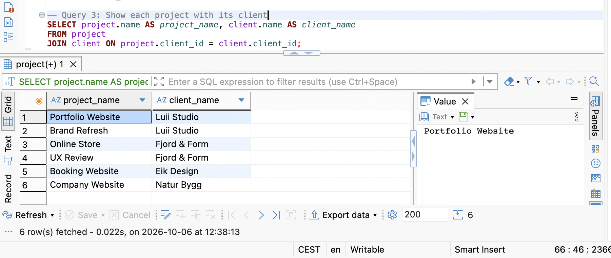
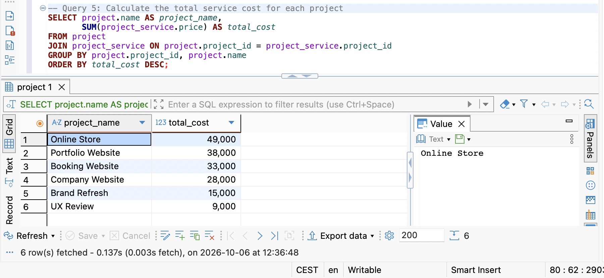
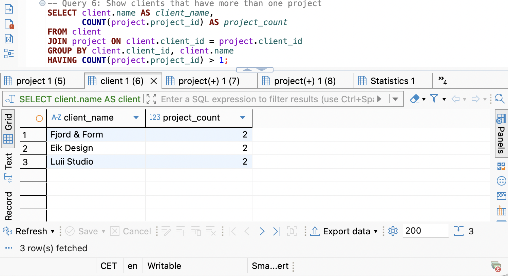
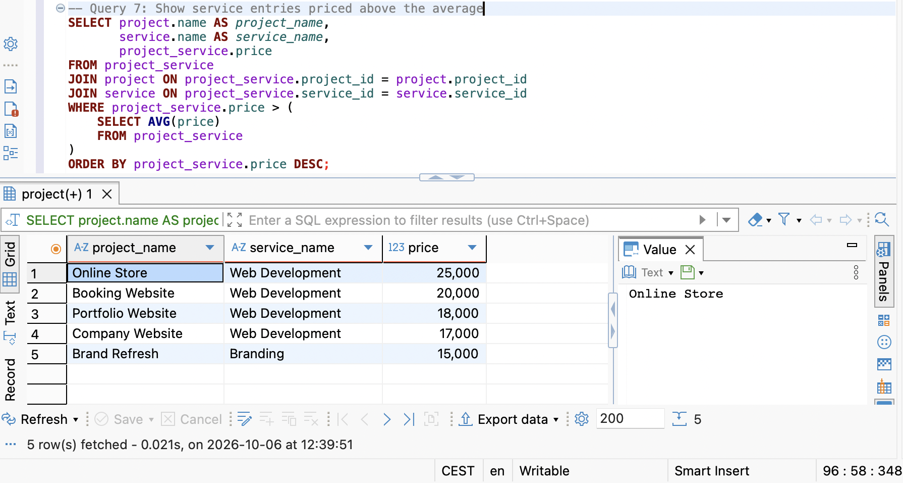
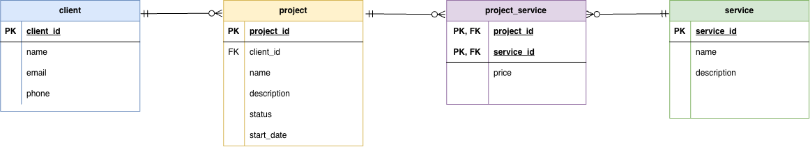

# PRO2003 - Work Requirement 1 & 2

PostgreSQL database design, implementation, and querying for Work Requirements 1 and 2.

### Files

- `schema.sql` contains the database structure and relationships.
- `data.sql` contains the test data and the `INSERT`, `UPDATE`, and `DELETE` statements.
- `queries.sql` contains the eight documented queries used to retrieve and analyze the data.

## Work Requirement 2

For Work Requirement 2, I continued working with the database created in Work Requirement 1.

The database was populated with test data for clients, projects, services, and the services assigned to each project. The data was added and modified using SQL statements with `INSERT INTO`, `UPDATE`, and `DELETE FROM`.

The `queries.sql` file contains eight SELECT queries used to retrieve and analyze the data. The queries include filtering and sorting, joins between related tables, aggregate functions, grouping with `GROUP BY` and `HAVING`, and a subquery.

### Query Results

The following screenshots show examples of the queries executed in DBeaver.

#### JOIN

This query combines project and client data to show which client each project belongs to.

#### Aggregate Function and GROUP BY

This query calculates the total service cost for each project using `SUM` and `GROUP BY`.

#### GROUP BY and HAVING

This query counts the projects for each client and uses `HAVING` to show clients with more than one project.

#### Subquery

This query uses a subquery to find service entries with a price above the average service price.

### How to Run

A running PostgreSQL server and a database client such as DBeaver are required.

1. Connect to PostgreSQL using DBeaver or another database management tool.

2. Create a new PostgreSQL database, or connect to an existing empty database, and open an SQL editor.

3. Copy the contents of `schema.sql` and paste it into the SQL editor. Run the complete script using **Execute SQL Script** (`Option + X` on Mac). This creates the four database tables and their relationships.

4. Refresh `Schemas → public → Tables` in DBeaver to verify that the tables have been created.

5. Copy the contents of `data.sql` and paste it into the SQL editor. Run the complete script using **Execute SQL Script** (`Option + X` on Mac). This populates the database with test data and executes the included `INSERT`, `UPDATE`, and `DELETE` statements.

6. Copy the queries from `queries.sql` into the SQL editor. To run a query individually, place the cursor inside the query and use **Execute SQL Statement** (`Command + Enter` on Mac). The results are displayed in the results panel below the SQL editor.

### Setup and Testing

The database was created using PostgreSQL running in Docker and tested through DBeaver. The database setup was tested from scratch by running `schema.sql` followed by `data.sql`. All eight queries in `queries.sql` were then executed successfully against the populated database.

## Work Requirement 1

### Domain

This database is designed for a small web and design studio. It is used to manage clients, their projects, and the services included in each project.

### Database Design

The database consists of four tables:

- `client` stores information about the studio's clients.
- `project` stores projects and connects each project to a client.
- `service` stores the services offered by the studio.
- `project_service` connects projects and services.

### Relationships

There is a one-to-many relationship between `client` and `project`. One client can have multiple projects, while each project belongs to one client.

There is a many-to-many relationship between `project` and `service`. A project can include multiple services, and the same service can be included in multiple projects.

This many-to-many relationship is resolved through the `project_service` table. Each record in `project_service` connects one project to one service, creating two one-to-many relationships: `project` to `project_service` and `service` to `project_service`.

### Design Decisions

The `client`, `project`, and `service` tables use automatically generated integer primary keys. This provides each record with a unique identifier without requiring IDs to be assigned manually.

The price is stored in `project_service` rather than `service`, because the price of a service may vary between projects.

The combination of `project_id` and `service_id` is used as a composite primary key to prevent the same service from being added to the same project more than once.

### ER Diagram

The ER diagram shows the structure of the database and the relationships between the four tables. Crow's Foot notation is used to represent the one-to-many and many-to-many relationships.

