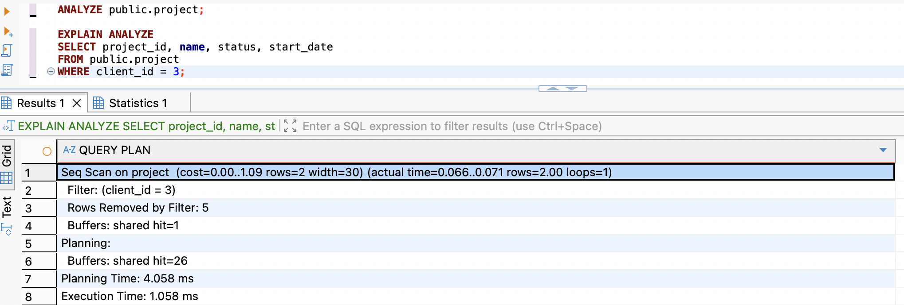
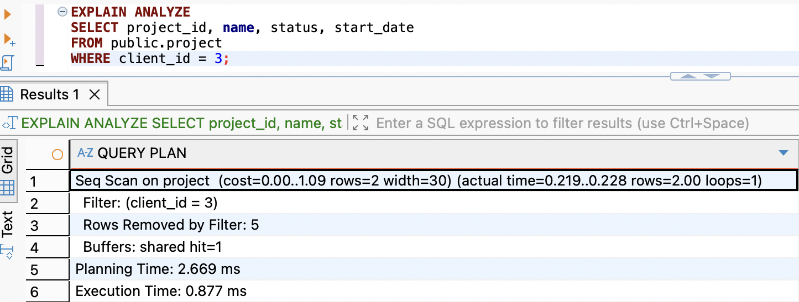
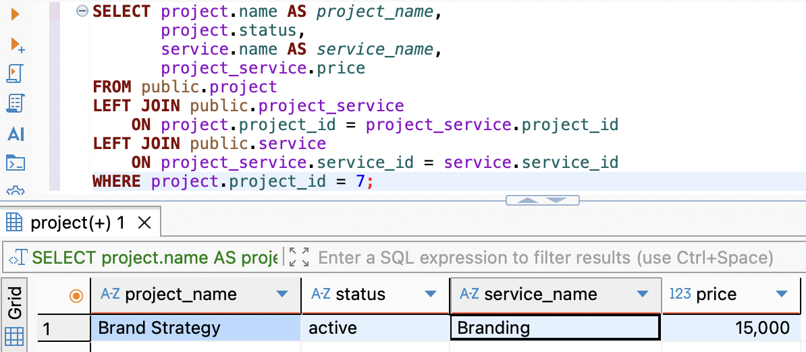
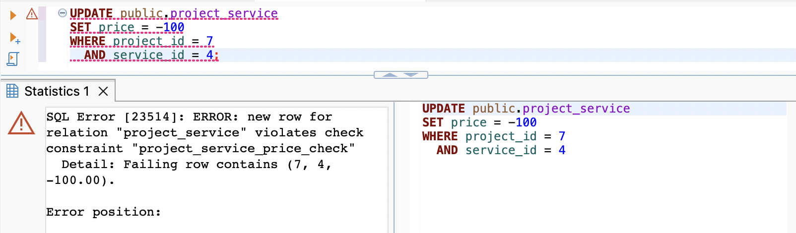
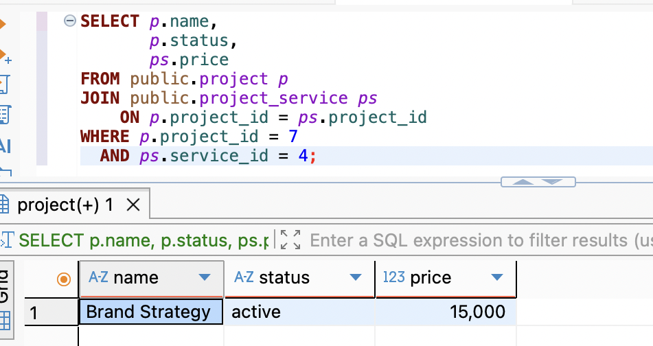
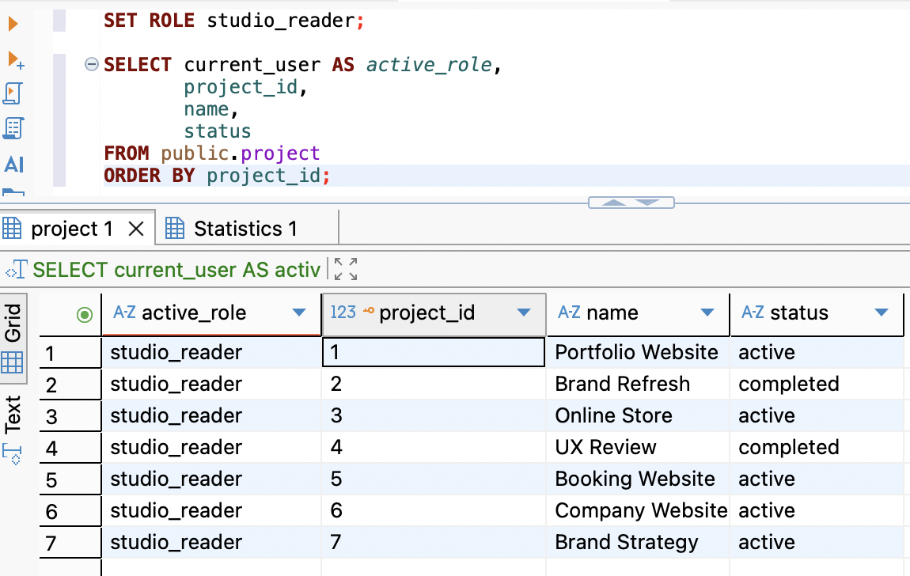
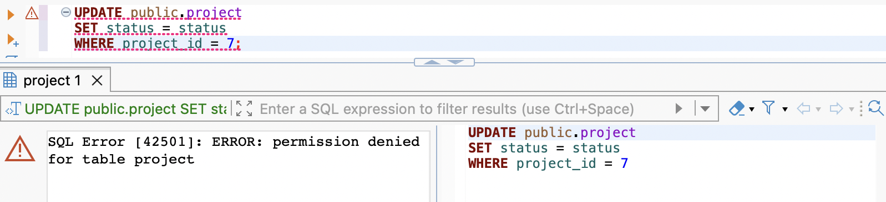
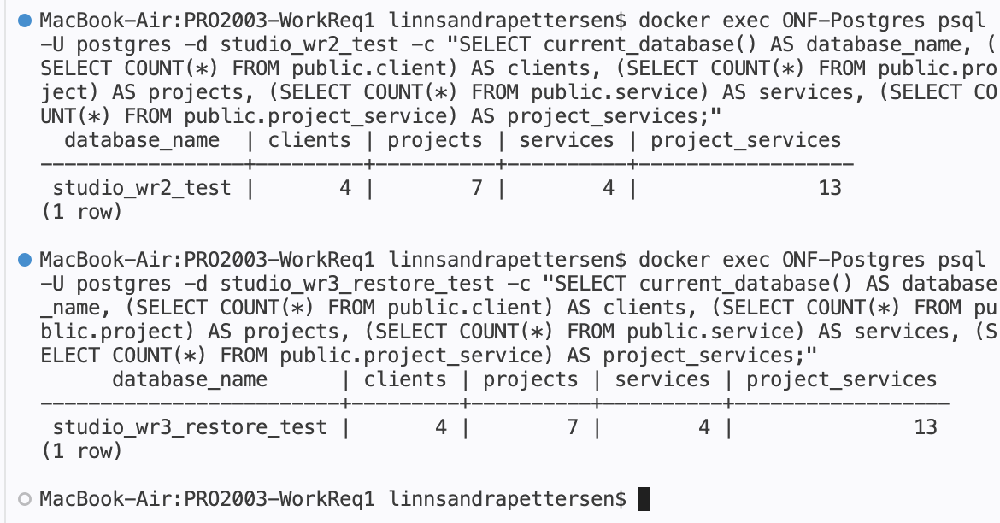
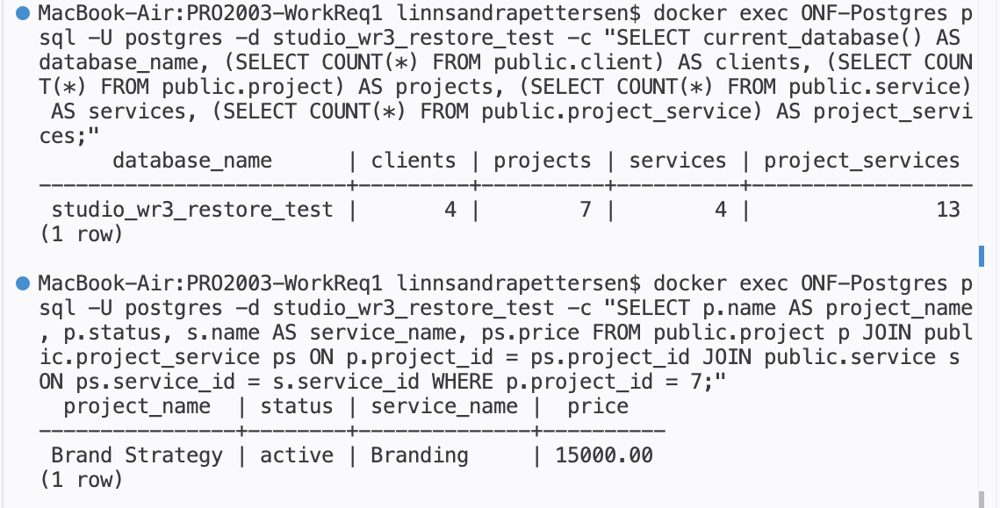

# PRO2003 - Work Requirements 1, 2 & 3

PostgreSQL database design, implementation, querying, and administration for Work Requirements 1, 2, and 3.

### Files

- `database/schema.sql` contains the database structure and relationships.
- `database/data.sql` contains the test data and the `INSERT`, `UPDATE`, and `DELETE` statements.
- `database/queries.sql` contains the eight documented queries used to retrieve and analyze the data.
- `database/index.sql` contains the commands used to compare query plans before and after adding an index.
- `database/transactions.sql` demonstrates related changes using ROLLBACK and COMMIT.
- `database/roles.sql` contains the role setup and permission tests.
- `backups/studio_wr3_backup.dump` contains the database backup taken after the successful COMMIT test.

## Work Requirement 3

### Third Normal Form (3NF) Review

I reviewed the database structure and found that it follows Third Normal Form based on the intended business rules.

**First Normal Form (1NF):** Each column contains a single value, and each row is identified by a primary key. Services assigned to a project are stored as separate rows in project_service rather than as a list in the project table.

**Second Normal Form (2NF):** The client, project, and service tables have single-column primary keys. In project_service, the price depends on the full composite key of project_id and service_id. A service can have different prices in different projects, so neither ID alone determines the price.

**Third Normal Form (3NF):** There are no known transitive dependencies between non-key attributes. Client contact details are stored in client, project details in project, and service descriptions in service. For example, project stores client_id as a reference rather than repeating the client's name, email, and phone number.

No structural changes were needed for this part of the assignment.

### How to Run

PostgreSQL and a database client such as DBeaver are required.
The backup commands also require Docker and use the container name
ONF-Postgres. Adjust the container and database names to match your setup.

1. Connect to PostgreSQL as an administrator and create an empty
   database. The examples use `studio_wr2_test`.
2. Open an SQL editor connected to this database and run `database/schema.sql`
   to create the tables and relationships.
3. Run `database/data.sql` to populate the tables with test data.
4. Run the queries in `database/queries.sql` before the transaction test to
   reproduce the Work Requirement 2 results.
5. Run `database/index.sql` and compare the EXPLAIN ANALYZE results before
   and after the index is created.
6. Run Tests 1 and 2 in `database/transactions.sql` once, in order, to test
   ROLLBACK and COMMIT. Then run Test 3 statement by statement in
   the same connection. It intentionally causes a CHECK constraint
   error. Execute ROLLBACK after the error, then run the verification
   query. The final state is Brand Strategy active with Branding
   assigned at 15,000.
7. Follow `database/roles.sql` to create and test the limited role.
   Create the role only once per PostgreSQL server. Run the
   expected failing UPDATE separately, followed by RESET ROLE.
8. Follow the Backup and Restore section to create a backup,
   restore it into a separate empty database, and verify the results.

In DBeaver on Mac, use Execute SQL Script (`Option + X`) to run
a complete script, except where individual execution is specified.
To run one statement, place the cursor inside it and use
Execute SQL Statement (`Command + Enter`).

### Index Evaluation

I evaluated an index on project.client_id using a query that retrieves projects for one client. This is relevant when looking up a client's projects.

The comparison was performed in studio_wr2_test with seven projects. I ran ANALYZE before the comparison to update the table statistics. The commands are included in database/index.sql.

#### Before Adding the Index

PostgreSQL used a sequential scan (Seq Scan), reading the table and filtering on client_id = 3. The query returned two projects and removed five rows through the filter. The estimated cost was 0.00–1.09, and the execution time was 1.058 ms.



#### After Adding the Index

I created idx_project_client_id on project.client_id and ran the same query again.

PostgreSQL still chose a sequential scan. The estimated cost remained 0.00–1.09, with two matching rows and five rows removed by the filter. The execution time was 0.877 ms.



#### Assessment

The index was not used for this query. With only seven rows, PostgreSQL estimated that reading the entire table was cheaper than using the index.

The slightly lower execution time does not demonstrate an improvement from the index, since the scan method stayed the same and individual timings can vary.

The index may become useful with more projects when a query retrieves a small proportion of the rows. However, it also requires storage and maintenance when data changes, so its value should be reassessed as the database grows.

### Transactions

The `database/transactions.sql` file demonstrates two related changes in one
transaction: assigning Branding to Brand Strategy at a price of
15,000 and changing the project's status from planned to active.

I first tested the changes using BEGIN and ROLLBACK. After ROLLBACK,
the project was still planned and had no assigned services, confirming
that both changes had been undone.

I then repeated the transaction using COMMIT. A query after COMMIT
confirmed that the project was active and Branding was assigned at
a price of 15,000.

Grouping these changes in a transaction allows them to be committed
together. If a statement fails, the transaction cannot commit the
partial changes and can be rolled back.



#### Failed Transaction

I also tested a transaction that first changed Brand Strategy to
completed, then attempted to set its service price to -100.
PostgreSQL rejected the negative price because it violated
CHECK (price >= 0).



After ROLLBACK, the project was still active and the price was
15,000. This confirmed that the earlier status change was also undone.



#### Running the Script
Tests 1 and 2 expect Brand Strategy (project 7) to be planned with
no assigned services. Repeating them after COMMIT causes a
duplicate-key error because Branding (service 4) is already assigned.

After the committed transaction, Brand Strategy no longer appears
in Query 2 or Query 8, and the service and cost results change.

### Roles and Permissions

The `database/roles.sql` file creates `studio_reader`, a NOLOGIN role intended
for reading data. It receives USAGE on the public schema and SELECT
on client, project, service, and project_service.

I tested the role using SET ROLE studio_reader. A SELECT query
returned all seven projects and displayed studio_reader as the
current user.



I then attempted an UPDATE on project. PostgreSQL rejected it with
"permission denied for table project", confirming that the role
could read this table but could not update it.



After testing, I used RESET ROLE to return to postgres.

Run the setup as an administrator against the assignment database.
The role is shared across the PostgreSQL server and should only be
created once. Run the expected failing UPDATE separately, then run
RESET ROLE separately afterwards.

### Backup and Restore

I used PostgreSQL's command-line tools inside Docker to back up
`studio_wr2_test` and restore it into a separate database named
`studio_wr3_restore_test`.

The backup was taken after the committed transaction, so it includes
Brand Strategy with status active and Branding assigned at 15,000.
The later failed transaction was rolled back and did not change
these values.

#### Before Restoring

The backup includes database objects, data, and object permissions.
PostgreSQL roles are server-wide and are not included by pg_dump.
The `studio_reader` role already existed because this restore test
used the same PostgreSQL server.

On another server, create the role before restoring if it does not
already exist. Run this SQL as an administrator:

```sql
CREATE ROLE studio_reader NOLOGIN;
```

Run the terminal commands below from the project directory.
The Docker container must be running. Adjust the container and
database names to match your setup.

The restore database must not already exist, because createdb
creates it. Do not run `database/schema.sql` or `database/data.sql`
in that database before restoring: the backup already contains
the tables and data.

#### Create and Restore a Backup

```bash
# Create the backup folder.
mkdir -p backups

# Create a backup in PostgreSQL custom format.
docker exec ONF-Postgres pg_dump -U postgres -d studio_wr2_test -Fc > backups/studio_wr3_backup.dump

# Create an empty database for the restore test.
docker exec ONF-Postgres createdb -U postgres studio_wr3_restore_test

# Restore the backup, stopping if an error occurs.
docker exec -i ONF-Postgres pg_restore -U postgres -d studio_wr3_restore_test --exit-on-error < backups/studio_wr3_backup.dump
```

To restore the included backup, skip the backup creation commands
and run only the createdb and pg_restore commands.

#### Verification

I ran the following queries against the restored database to check
the database name, count the rows in all four tables, and verify
the committed changes to Brand Strategy:

```bash
docker exec ONF-Postgres psql -U postgres -d studio_wr3_restore_test -c "SELECT current_database() AS database_name, (SELECT COUNT(*) FROM public.client) AS clients, (SELECT COUNT(*) FROM public.project) AS projects, (SELECT COUNT(*) FROM public.service) AS services, (SELECT COUNT(*) FROM public.project_service) AS project_services;"

docker exec ONF-Postgres psql -U postgres -d studio_wr3_restore_test -c "SELECT p.name AS project_name, p.status, s.name AS service_name, ps.price FROM public.project p JOIN public.project_service ps ON p.project_id = ps.project_id JOIN public.service s ON ps.service_id = s.service_id WHERE p.project_id = 7;"
```

I compared row counts in the original database, studio_wr2_test,
and the restored database, studio_wr3_restore_test. Both contained
4 clients, 7 projects, 4 services, and 13 project-service entries.



The restored database also contained Brand Strategy with status
active and Branding assigned at 15,000, as expected.



<details>
<summary>WorkReq2. Administer your PostgreSQL Database.</summary>

## Work Requirement 2

For Work Requirement 2, I continued working with the database created in Work Requirement 1.

The database was populated with test data for clients, projects, services, and the services assigned to each project. The data was added and modified using SQL statements with `INSERT INTO`, `UPDATE`, and `DELETE FROM`.

The `database/queries.sql` file contains eight SELECT queries used to retrieve and analyze the data. The queries include filtering and sorting, joins between related tables, aggregate functions, grouping with `GROUP BY` and `HAVING`, and a subquery.

### Query Results

The following screenshots show examples of the queries executed in DBeaver.

#### JOIN

This query combines project and client data to show which client each project belongs to.


#### Aggregate Function and GROUP BY

This query calculates the total service cost and counts the services assigned to each project using SUM, COUNT, and GROUP BY. Only projects with assigned services are included.


#### GROUP BY and HAVING

This query counts the projects for each client and uses `HAVING` to show clients with more than one project.


#### Subquery

This query uses a subquery to find service entries with a price above the average service price.


### Improvements After Feedback

I added a planned project, Brand Strategy, so the test data still includes active, completed, and planned projects after the UPDATE statement.

Query 1 now shows active projects with their clients, ordered by start date. Query 2 shows planned projects starting from November 2026, including the client for each project.

I combined the total service cost and service count into Query 5 because they use the same join and grouping. Query 8 now finds projects without assigned services using LEFT JOIN and IS NULL. Brand Strategy provides a test case for this query.

### How to Run

A running PostgreSQL server and a database client such as DBeaver are required.

1. Connect to PostgreSQL using DBeaver or another database management tool.

2. Create a new PostgreSQL database, or connect to an existing empty database, and open an SQL editor.

3. Copy the contents of `database/schema.sql` and paste it into the SQL editor. Run the complete script using **Execute SQL Script** (`Option + X` on Mac). This creates the four database tables and their relationships.

4. Refresh `Schemas → public → Tables` in DBeaver to verify that the tables have been created.

5. Copy the contents of `database/data.sql` and paste it into the SQL editor. Run the complete script using **Execute SQL Script** (`Option + X` on Mac). This populates the database with test data and executes the included `INSERT`, `UPDATE`, and `DELETE` statements.

6. Copy the queries from `database/queries.sql` into the SQL editor. To run a query individually, place the cursor inside the query and use **Execute SQL Statement** (`Command + Enter` on Mac). The results are displayed in the results panel below the SQL editor.

### Setup and Testing

The database runs in PostgreSQL using Docker and is tested through DBeaver.

After the improvements, the complete setup was tested in a separate empty database named studio_wr2_test. I ran schema.sql, followed by data.sql, and then all eight queries in queries.sql. All scripts completed without errors, and the query results matched the expected data.

</details>

<details>
<summary>WorkReq1. Design and create a PostgreSQL Database.</summary>

## Work Requirement 1

### Domain

This database is designed for a small web and design studio. It is used to manage clients, their projects, and the services included in each project.

### Database Design

The database consists of four tables:

- `client` stores information about the studio's clients.
- `project` stores projects and connects each project to a client.
- `service` stores the services offered by the studio.
- `project_service` connects projects and services.

### Relationships

There is a one-to-many relationship between `client` and `project`. One client can have multiple projects, while each project belongs to one client.

There is a many-to-many relationship between `project` and `service`. A project can include multiple services, and the same service can be included in multiple projects.

This many-to-many relationship is resolved through the `project_service` table. Each record in `project_service` connects one project to one service, creating two one-to-many relationships: `project` to `project_service` and `service` to `project_service`.

### Design Decisions

The `client`, `project`, and `service` tables use automatically generated integer primary keys. This provides each record with a unique identifier without requiring IDs to be assigned manually.

The price is stored in `project_service` rather than `service`, because the price of a service may vary between projects.

The combination of `project_id` and `service_id` is used as a composite primary key to prevent the same service from being added to the same project more than once.

### ER Diagram

The ER diagram shows the structure of the database and the relationships between the four tables. Crow's Foot notation is used to represent the one-to-many and many-to-many relationships.


</details>